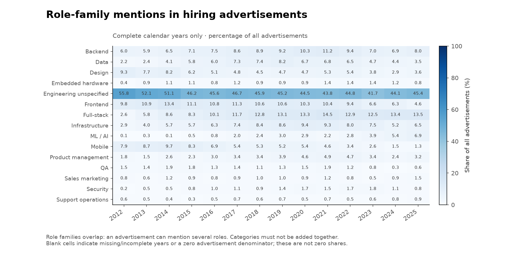
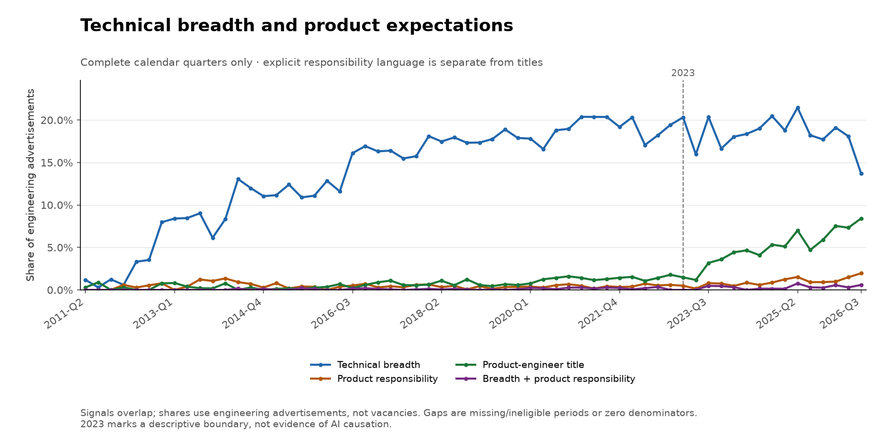
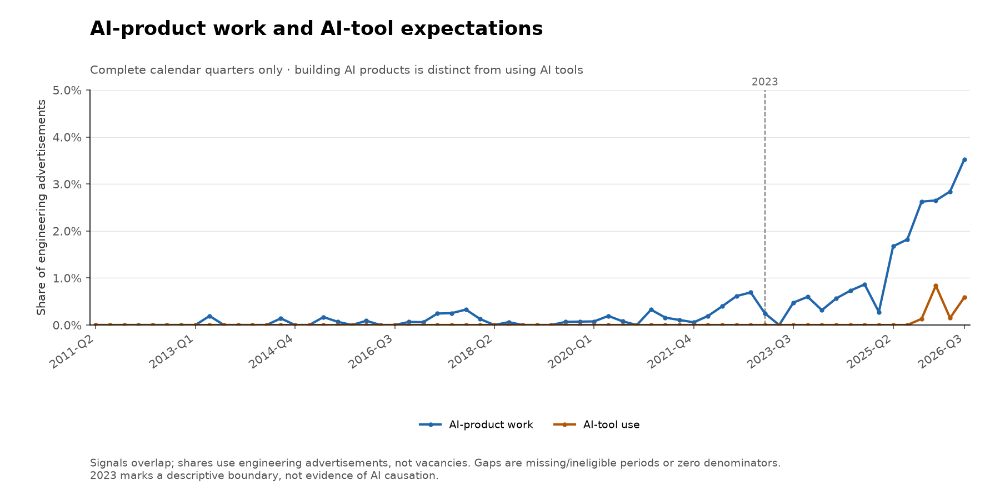
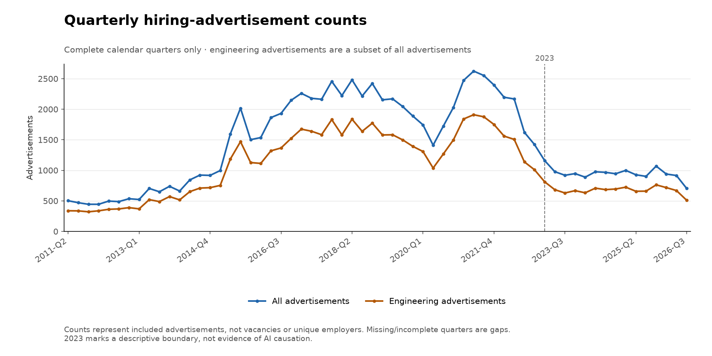
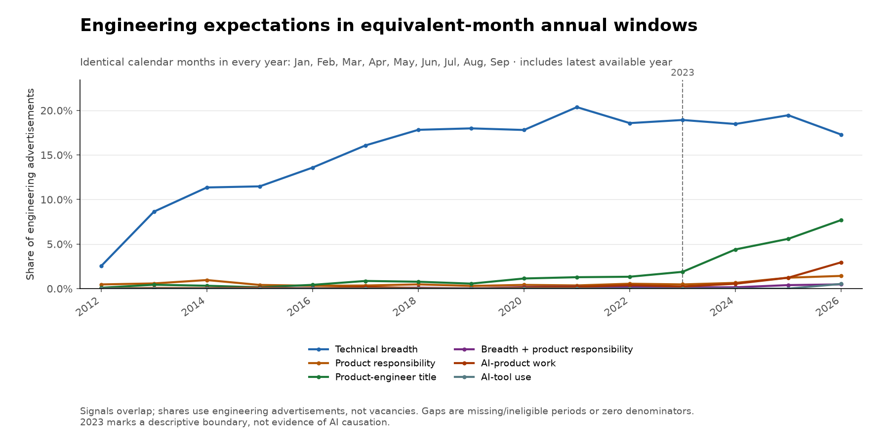
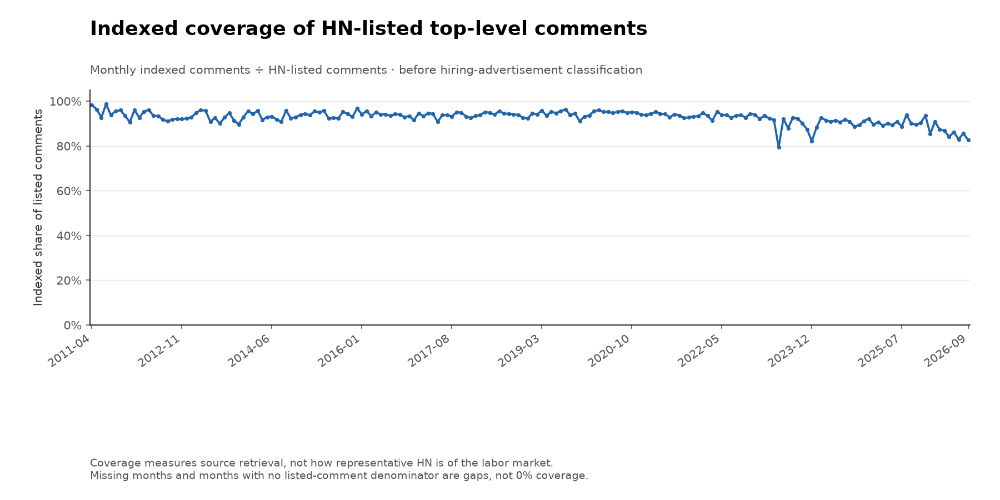

# HN hiring advertisement trends

Requested window: **2011-04–2026-09**. This is a descriptive study of explicit language in indexed HN advertisements, not a labor-market census.

**Classification is an unvalidated rules-based baseline. Detected signals are not estimates of actual job responsibilities or AI adoption.**

## Sample and coverage

- Canonical monthly threads found: **186 / 186**.
- Missing monthly threads: **none**.
- HN-listed top-level comments: **101,908**; present in the index: **94,954**.
- HN-listed comments absent from the index: **6,954**. Their visibility/deletion status is not inferred. Coverage changes can affect trends.
- Retained advertisements: **88,170**; with explicit engineering-role language: **64,358**.
- Excluded indexed comments: **6,784**, including **167** same-month exact-text duplicates and **6** comments posted outside their thread month.

## Equivalent-month comparison

Calendar months used in every compared year: **01, 02, 03, 04, 05, 06, 07, 08, 09**. Years missing any comparison month are excluded. Role shares use all retained advertisements; responsibility and AI-signal shares use retained engineering advertisements.

| Explicit signal | 2022 | 2026 |
|---|---:|---:|
| frontend | 9.4% (565/5986) | 3.1% (79/2559) |
| backend | 9.5% (568/5986) | 9.1% (233/2559) |
| full stack | 12.8% (769/5986) | 12.5% (319/2559) |
| ml ai | 2.7% (159/5986) | 6.3% (162/2559) |
| technical breadth | 18.6% (781/4204) | 17.3% (328/1897) |
| product responsibility | 0.5% (23/4204) | 1.4% (27/1897) |
| product engineer title | 1.3% (56/4204) | 7.7% (146/1897) |
| breadth and product | 0.2% (8/4204) | 0.5% (9/1897) |
| ai product work | 0.4% (16/4204) | 3.0% (56/1897) |
| ai tool use | 0.0% (0/4204) | 0.5% (10/1897) |

## Descriptive change in trajectory

Separate straight-line fits use complete quarters before 2023 and from 2023 onward, with each quarter weighted equally. Slopes are percentage points per year. A slope difference is not evidence that AI caused a change, and these fits do not provide uncertainty estimates or adjust for economic conditions or repeated advertisers.

| Explicit signal | Before 2023 | From 2023 | Difference |
|---|---:|---:|---:|
| frontend | +0.01 | -1.30 | -1.30 |
| backend | +0.52 | +0.66 | +0.14 |
| full stack | +1.14 | -0.06 | -1.20 |
| ml ai | +0.31 | +1.02 | +0.71 |
| technical breadth | +1.60 | -0.41 | -2.02 |
| product responsibility | -0.00 | +0.33 | +0.33 |
| product engineer title | +0.11 | +1.76 | +1.65 |
| ai product work | +0.03 | +0.93 | +0.91 |
| ai tool use | +0.00 | +0.14 | +0.14 |
| breadth and product | +0.02 | +0.10 | +0.08 |

## Charts

## Interpretation limits

- HN overrepresents technology companies and startups. Advertisements are not vacancies, hires, layoffs, or employment totals.
- Labels overlap. A multi-role advertisement may mention several specialties and responsibilities; co-occurrence does not prove one engineer is expected to perform them all.
- Technical breadth requires explicit full-stack or cross-stack responsibility language, not merely separate frontend and backend openings.
- Product-engineer titles are separate from product responsibilities. Advertised AI-product duties are separate from expectations to use AI development tools; company descriptions alone do not establish either.
- Rules detect explicit language, not actual skills or workplace behavior. Changing vocabulary, job-ad length, source availability, and classification errors can affect the result.
- A separately labeled, representative benchmark across eras is required before using these measurements as strong evidence or claiming classification precision/recall. Manual example inspection and behavioral tests do not provide that validation.
- Repeated advertisements across months remain observations of advertised demand; they are not independent employers. Only exact-text duplicates within a month are removed.
- `review_examples.csv` contains deterministic era samples and deliberately selected positive/negative examples. The latter are not representative and must not be used to estimate accuracy. Full text is available locally in `review_sample.jsonl`.
- This dataset cannot establish AI causality, explain layoffs, or validate a five-year employment forecast.

## Reproducibility

The manifest identifies classified data with SHA-256 **`8854fbd3c0b0f544f0c356a35e49e4ee1373871fc9d5e4d69058b3db3c938e78`**. Original source responses and retrieval timestamps are cached locally. Use the cached offline rerun to reproduce this snapshot; a fresh collection can differ as comments and the index change.
