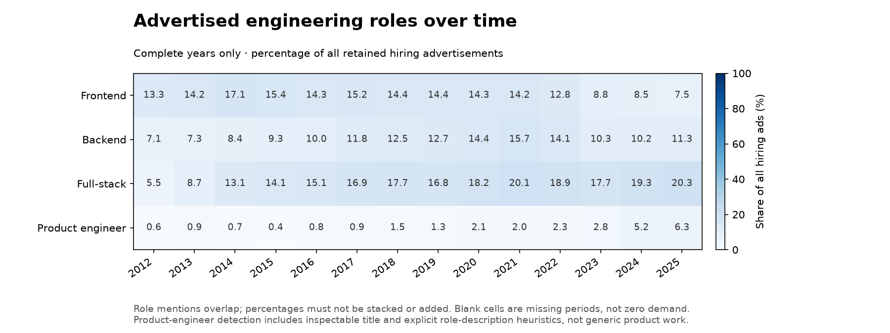
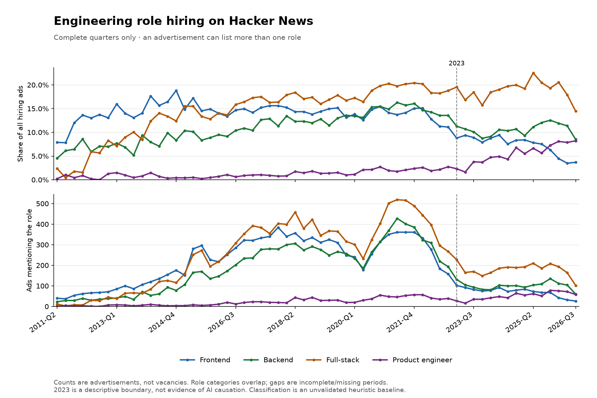
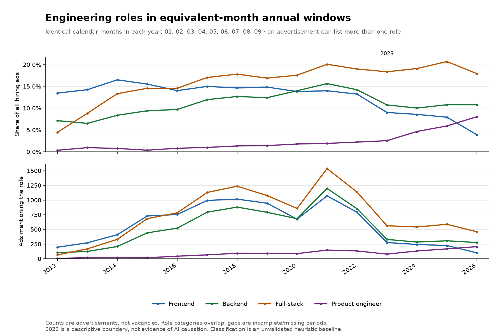

# Frontend, backend, full-stack, and product-engineer hiring

Window: **2011-04–2026-09**. Measurements describe detected role advertisements in HN's hiring community, not vacancies or the wider labor market.

**This is an unvalidated heuristic baseline. Better candidate capture does not establish complete recall or classification accuracy.**

## Sample and denominator

- Canonical monthly threads: **186 / 186**; missing months: **none**.
- Indexed top-level comments: **94,954 / 101,908** HN-listed IDs; **6,954** are absent from the index.
- Retained hiring advertisements: **88,628**; detected product-engineer ads: **1,763**.
- Ads identified by an explicit advertised role rather than conventional hiring text: **458**.
- Excluded comments: **6,326**, including **167** exact same-month duplicates and **6** outside-month comments.

Every percentage uses **all retained hiring advertisements** as its denominator, not just engineering ads. An ad can list more than one of the four roles; categories overlap and must not be stacked or added together.

## Equivalent-month comparison

Every eligible year uses the same calendar months: **01, 02, 03, 04, 05, 06, 07, 08, 09**. Years missing any comparison month are excluded.

| Advertised role | 2022 | 2026 |
|---|---:|---:|
| Frontend | 13.2% (792/5989) | 3.9% (100/2561) |
| Backend | 14.2% (852/5989) | 10.8% (276/2561) |
| Full-stack | 19.0% (1137/5989) | 17.9% (459/2561) |
| Product engineer | 2.2% (133/5989) | 8.0% (206/2561) |

## Charts

## Inspect product-engineer capture

`product_engineer_matches.csv` includes every detected product-role ad with its source, matched evidence, and heuristic reasons. `product_engineer_candidates.csv` includes broad product/engineering candidates not counted as product roles, including excluded comments, so missed or ambiguous cases remain inspectable. `review_examples.csv` adds deterministic era samples and selected role/candidate examples; it is not an accuracy benchmark.

## Interpretation limits

- HN disproportionately represents technology companies and startups. Ads are not vacancies, hires, layoffs, or unique employers.
- Product-focused role descriptions and qualified/reversed titles can qualify, but merely building a product, working with product managers, or serving product engineers does not.
- English title/role heuristics can miss uncommon wording or confuse the subject of a description. Source-locatable evidence is not proof of correct attribution.
- A representative, independently labeled cross-era benchmark is required before claims of complete capture, precision/recall, or strong substantive conclusions.
- Vocabulary, ad length, repeated advertisers, employer mix, and changing indexed coverage can affect trends. Unindexed comments are not assumed to be live, deleted, or representative.
- Only exact-text duplicates within a month are removed. Repeated advertisements in different months remain observations of advertised demand.
- Complete-quarter/year charts exclude incomplete periods; equivalent-year charts use identical calendar months. Missing periods are gaps, not zero demand.
- Any pre/post-2023 slopes in `descriptive_trends.csv` are unweighted descriptive fits to complete-quarter shares, not causal models or significance tests.
- This dataset cannot explain layoffs, establish AI causality, or validate a future employment forecast.

## Reproducibility

Classified-data SHA-256: `a757249f8d756db1c6f97840598754638b66897ae0318a236560984d5f57ec0b`. Original JSON source responses and retrieval timestamps are cached locally. Exact replay requires those original caches; a fresh collection of the same months can differ.
